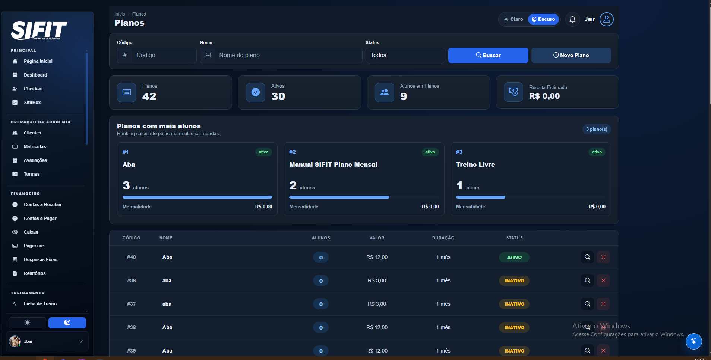
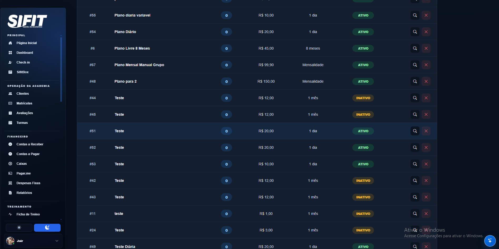

# CT048 - Planos cadastrados com nomes repetidos

## Objetivo
Verificar se a lista de planos do filtro permite identificar cada plano sem ambiguidade.

## Pré-condições
- Usuário autenticado no SIFIT.
- Acesso ao módulo Clientes e ao menu Comercial > Planos.

## Passos para execução
1. Acessar o menu Clientes, abrir o filtro "Plano" e selecionar o plano "Teste".
2. Acessar o menu Comercial > Planos.
3. Rolar a listagem e observar os nomes dos planos cadastrados.

## Resultado esperado
Cada plano deve aparecer com um nome único ou com alguma informação que diferencie planos parecidos.

## Resultado obtido
No filtro de Clientes existem várias opções com o mesmo nome e não é possível saber qual plano "Teste" foi selecionado (na gravação, a busca com "Teste" retornou a tabela vazia). Na tela de Planos fica claro o motivo: existem vários planos cadastrados com o mesmo nome, diferenciados apenas pelo código:
- "Teste": #24, #42, #43, #44, #45, #51, #52 e #53 (e "teste" #11), com valores e durações diferentes (R$ 3,00 a R$ 20,00; 1 dia ou 1 mês) e alguns ativos, outros inativos.
- "Aba"/"aba": #36, #37, #38, #39 e #40.

Como as listas de seleção mostram só o nome, o usuário não consegue distinguir, por exemplo, o "Teste" de R$ 20,00 / 1 dia (ativo) do "Teste" de R$ 12,00 / 1 mês (inativo).

## Status
⚠️ Aprovado com ressalva.

## Observação
A gravação no Jam mostra o filtro de planos sendo usado, mas não captura a lista aberta do campo de seleção. Como o limite mensal de gravações do Jam acabou, foram anexados prints da tela de Planos para mostrar os nomes repetidos. O objetivo é evidenciar que o sistema não deveria permitir planos com o mesmo nome, porque isso deixa a escolha confusa para o usuário.

## Evidência
[Visualizar gravação no Jam](https://jam.dev/c/f15ef9aa-7abb-4374-a863-89e81ed64e12)

Prints da tela de Planos:

