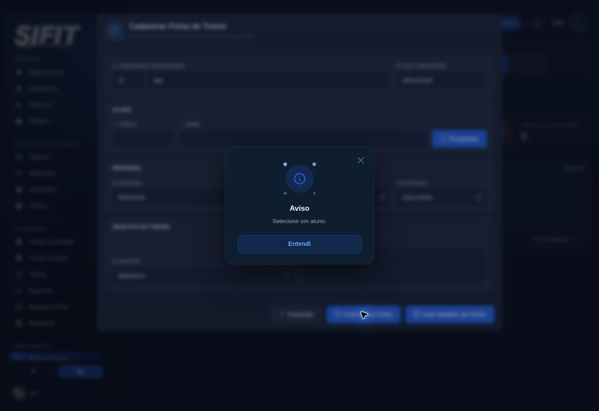

# CT062 - Ficha sem aluno

## Pré-condições

Sessão autenticada no SIFIT Alfa. Execução em 19/11/2026.

## Passos para execução

Abrir Fichas de Treino e clicar em Cadastrar Ficha. Deixar Aluno vazio e clicar em Criar Nova Ficha.

## Resultado esperado

Bloquear o cadastro e pedir a seleção de um aluno.

## Resultado obtido

O sistema exibiu o aviso “Selecione um aluno.” e manteve o formulário aberto.

## Status

Aprovado

## Evidência

