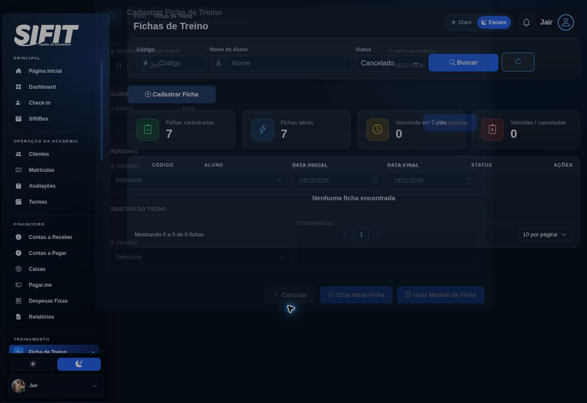

# CT064 - Filtro de fichas

## Pré-condições

Sessão autenticada no SIFIT Alfa. Execução em 19/11/2026.

## Passos para execução

Abrir Fichas de Treino. Selecionar Cancelado em Status e clicar em Buscar.

## Resultado esperado

Exibir apenas fichas canceladas ou informar que não existem correspondências.

## Resultado obtido

A listagem inicial tinha sete fichas ativas. Com o filtro Cancelado, exibiu “Nenhuma ficha encontrada” e zero resultados.

## Status

Aprovado para o filtro Status

## Evidência

