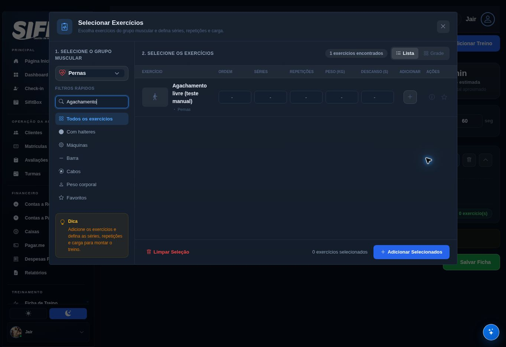

# CT065 - Busca de exercícios

## Objetivo

Verificar o caso de teste 065.

## Pré-condições

Sessão autenticada no SIFIT Alfa. Execução em 19/11/2026.

## Passos para execução

No editor da ficha de teste, adicione um treino e abra Adicionar Exercício. Selecione Pernas e pesquise Agachamento.

## Resultado esperado

Exibir os exercícios do grupo que correspondem ao termo.

## Resultado obtido

A busca exibiu um único resultado: Agachamento livre (teste manual).

## Status

Aprovado

## Evidência

