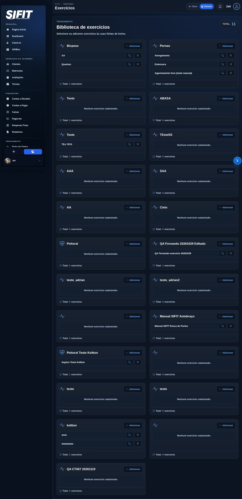

# CT066 - Exclusão de exercício

## Pré-condições

Sessão autenticada no SIFIT Alfa em 19/11/2026. Registros de teste existentes.

## Passos para execução

No grupo QA CT067 20261119, a integrante excluiu QA CT066 20261119. Recarreguei a biblioteca de exercícios e inspecionei o mesmo grupo.

## Resultado esperado

O exercício excluído deixa de aparecer.

## Resultado obtido

O grupo mostrou “Nenhum exercício cadastrado” e total zero. A confirmação da exclusão foi feita pela integrante.

## Status

Aprovado

## Evidência

