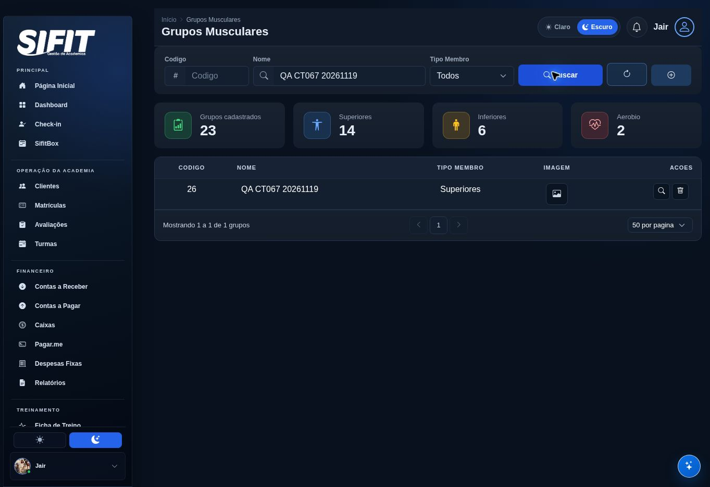

# CT067 - Cadastro válido de grupo muscular

## Objetivo

Verificar cadastro válido de grupo muscular.

## Pré-condições

Sessão autenticada no SIFIT Alfa. Execução em 19/11/2026.

## Passos para execução

Em Grupos Musculares, abra o cadastro, informe QA CT067 20261119, selecione Superiores e salve. Altere a paginação para 50 por página.

## Resultado esperado

O novo grupo aparece com nome e tipo informados.

## Resultado obtido

O grupo foi listado com código 26, nome QA CT067 20261119 e tipo Superiores. A busca pelo nome manteve a listagem geral, por isso a confirmação foi feita pela paginação.

## Status

Aprovado para o cadastro

## Evidência

