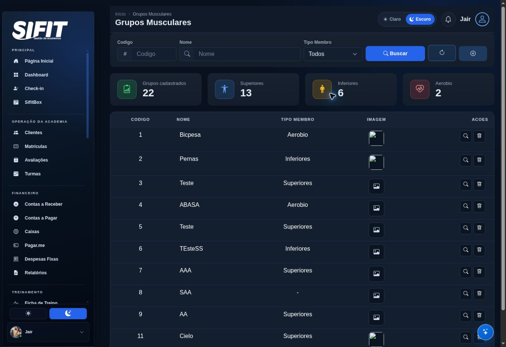

# CT068 - Grupo muscular sem nome

## Objetivo

Verificar grupo muscular sem nome.

## Pré-condições

Sessão autenticada no SIFIT Alfa. Execução em 19/11/2026.

## Passos para execução

Abra o cadastro, deixe Nome vazio, selecione Superiores e clique em Salvar.

## Resultado esperado

O formulário deve exigir o nome e impedir a inclusão.

## Resultado obtido

O formulário fechou após o envio e o total subiu de 21 para 22 grupos.

## Status

Reprovado

## Evidência

