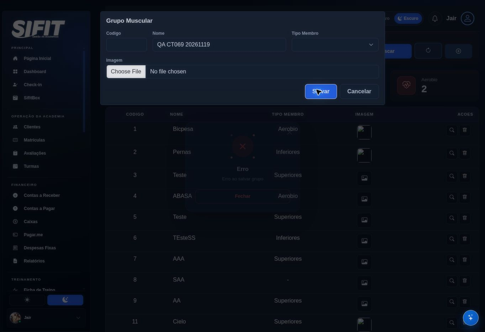

# CT069 - Grupo muscular sem tipo

## Objetivo

Verificar grupo muscular sem tipo.

## Pré-condições

Sessão autenticada no SIFIT Alfa. Execução em 19/11/2026.

## Passos para execução

Abra o cadastro, informe QA CT069 20261119, deixe Tipo Membro sem seleção e clique em Salvar.

## Resultado esperado

O formulário deve impedir a inclusão e indicar que o tipo é obrigatório.

## Resultado obtido

O formulário ficou aberto e o sistema exibiu “Erro ao salvar grupo”, sem indicar o campo obrigatório.

## Status

Bloqueio aprovado, mensagem reprovada

## Evidência

