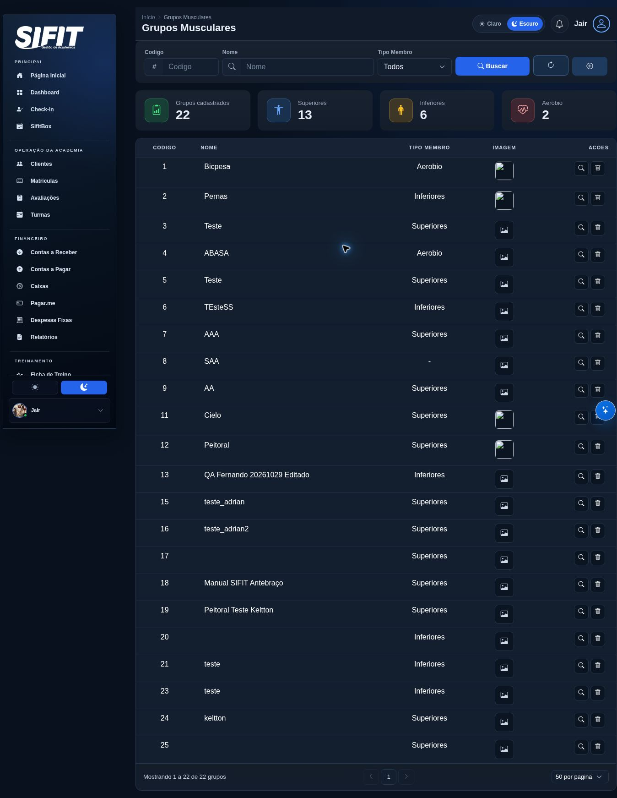

# CT070 - Exclusão de grupo muscular

## Pré-condições

Sessão autenticada no SIFIT Alfa em 19/11/2026. Registros de teste existentes.

## Passos para execução

Em Grupos Musculares, selecione 50 por página, localize QA CT067 20261119 (código 26), clique em Deletar e confirme. Recarregue a página para verificar a persistência.

## Resultado esperado

O grupo desaparece e permanece ausente após recarregar.

## Resultado obtido

O grupo deixou de aparecer e permaneceu ausente após recarregar.

## Status

Aprovado

## Evidência

