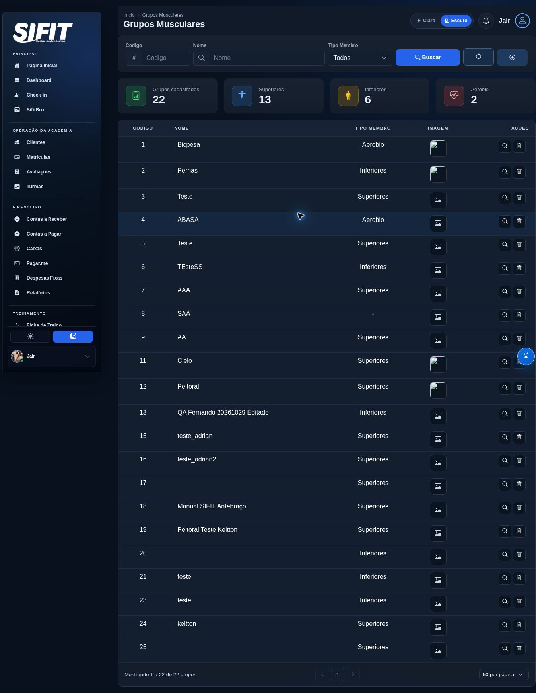

# CT071 - Atualização da lista após exclusão

## Pré-condições

Sessão autenticada no SIFIT Alfa em 19/11/2026. Registros de teste existentes.

## Passos para execução

Antes da exclusão do grupo 26, confira a linha e o contador. Após confirmar, aguarde a resposta e verifique a mesma página sem recarregar.

## Resultado esperado

A lista e o contador se atualizam automaticamente.

## Resultado obtido

A linha desapareceu e o contador caiu de 23 para 22 sem recarregar.

## Status

Aprovado

## Evidência

