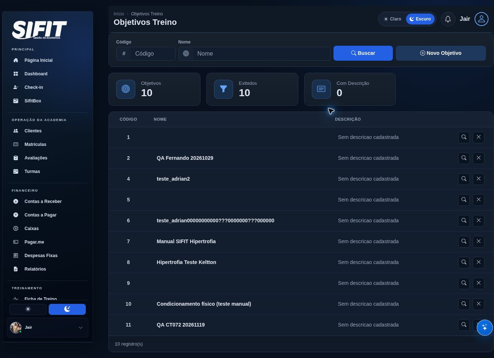

# CT072 - Cadastro de objetivo de treino

## Objetivo

Verificar cadastro de objetivo de treino.

## Pré-condições

Sessão autenticada no SIFIT Alfa. Execução em 19/11/2026.

## Passos para execução

Em Objetivos Treino, clique em Novo Objetivo, informe QA CT072 20261119 e uma descrição de teste, e salve.

## Resultado esperado

A listagem deve mostrar o novo objetivo com o nome e a descrição informados.

## Resultado obtido

O objetivo apareceu com código 11, mas a listagem exibiu “Sem descricao cadastrada”. A persistência da descrição ainda precisa ser conferida na edição.

## Status

Reprovado para exibição da descrição

## Evidência

