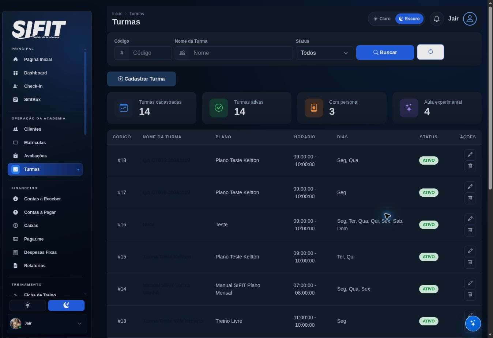

# CT073 - Cadastro de turma

## Objetivo

Verificar o caso de teste 073.

## Pré-condições

Sessão autenticada no SIFIT Alfa. Execução em 19/11/2026.

## Passos para execução

Em Turmas, clique em Cadastrar Turma. Informe QA CT073 20261119, Plano Teste Keltton, 1 mês, 09:00–10:00 e selecione segunda e quarta. Salve.

## Resultado esperado

Exibir a nova turma na listagem com o plano, os horários e os dias informados.

## Resultado obtido

A turma nº 18 apareceu como ativa, com Plano Teste Keltton, 09:00–10:00 e Seg, Qua.

## Status

Aprovado

## Evidência

