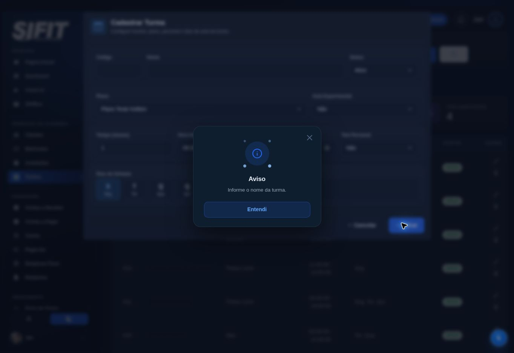

# CT074 - Turma sem nome

## Objetivo

Verificar o caso de teste 074.

## Pré-condições

Sessão autenticada no SIFIT Alfa. Execução em 19/11/2026.

## Passos para execução

No cadastro de turma, deixe Nome vazio. Selecione Plano Teste Keltton, 1 mês e segunda-feira. Clique em Salvar.

## Resultado esperado

Bloquear o cadastro e informar que o nome é obrigatório.

## Resultado obtido

O formulário permaneceu aberto e exibiu “Informe o nome da turma.”

## Status

Aprovado

## Evidência

