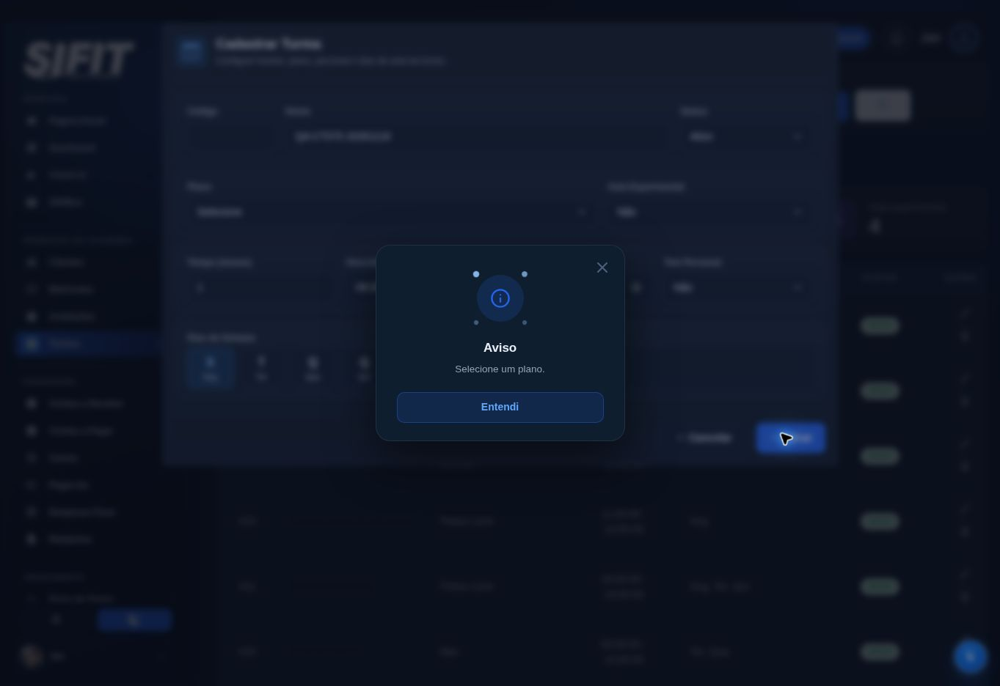

# CT075 - Turma sem plano

## Objetivo

Verificar o caso de teste 075.

## Pré-condições

Sessão autenticada no SIFIT Alfa. Execução em 19/11/2026.

## Passos para execução

Informe QA CT075 20261119, 1 mês e segunda-feira. Deixe Plano em Selecione e clique em Salvar.

## Resultado esperado

Bloquear o cadastro e solicitar um plano.

## Resultado obtido

O formulário permaneceu aberto e exibiu “Selecione um plano.”

## Status

Aprovado

## Evidência

