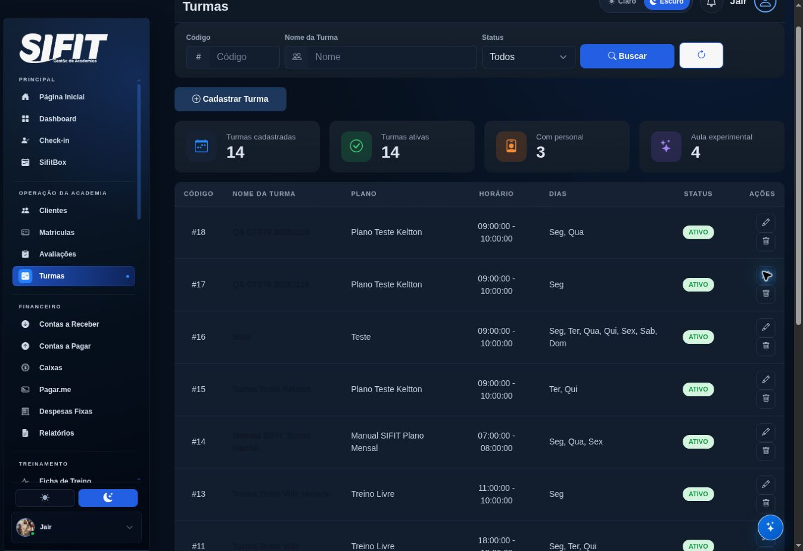

# CT076 - Turma com duração zero

## Objetivo

Verificar o caso de teste 076.

## Pré-condições

Sessão autenticada no SIFIT Alfa. Execução em 19/11/2026.

## Passos para execução

Informe QA CT076 20261119, Plano Teste Keltton, segunda-feira e 0 em Tempo (meses). Clique em Salvar.

## Resultado esperado

Rejeitar duração de zero meses e manter o formulário aberto com indicação do campo.

## Resultado obtido

A turma nº 17 foi cadastrada. Ao reabrir o registro, o campo de duração apareceu vazio.

## Status

Reprovado

## Evidência

