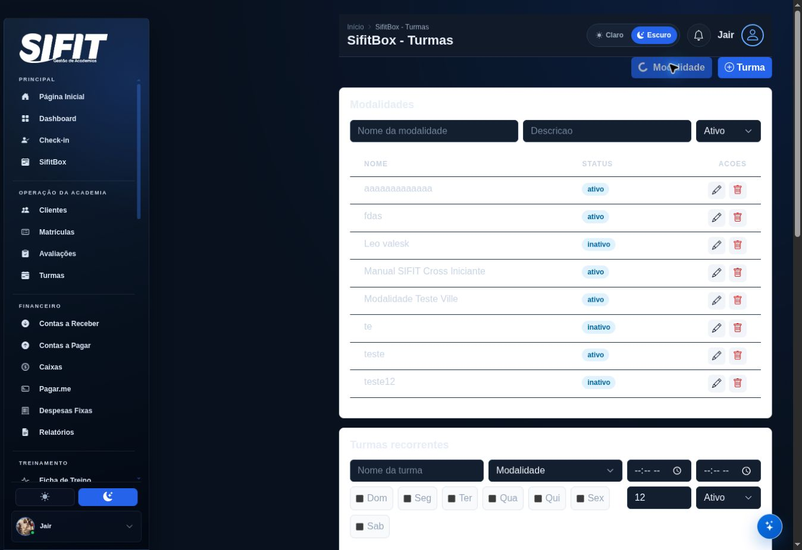

# CT077 - Cadastro de modalidade SifitBox

## Objetivo

Verificar o caso de teste 077.

## Pré-condições

Sessão autenticada no SIFIT Alfa. Execução em 19/11/2026.

## Passos para execução

Em Box - Turmas, preencha Nome da modalidade com QA CT077 20261119 e a descrição Modalidade de teste. Mantenha Ativo e clique em Modalidade.

## Resultado esperado

Exibir a modalidade ativa e disponibilizá-la para novas turmas.

## Resultado obtido

A modalidade apareceu na listagem e ficou disponível no seletor usado no CT078.

## Status

Aprovado

## Evidência

