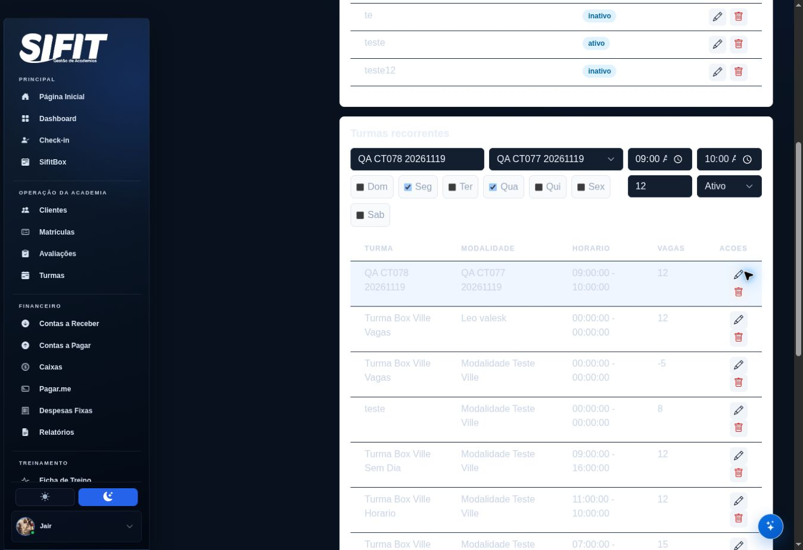

# CT078 - Cadastro de turma recorrente

## Objetivo

Verificar o caso de teste 078.

## Pré-condições

Sessão autenticada no SIFIT Alfa. Execução em 19/11/2026.

## Passos para execução

Em Box - Turmas, informe QA CT078 20261119, modalidade QA CT077 20261119, 09:00–10:00, segunda e quarta e 12 vagas. Clique em Turma e reabra o registro.

## Resultado esperado

Exibir a turma e preservar os dias de recorrência.

## Resultado obtido

A listagem mostrou a turma com modalidade, horários e vagas corretos. Na edição, Seg e Qua estavam marcados.

## Status

Aprovado

## Evidência

