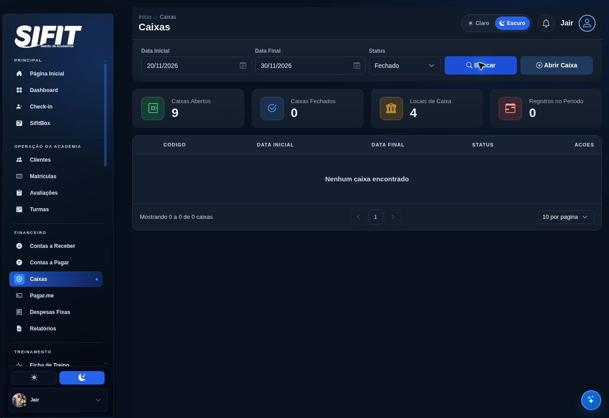

# CT088 - Caixa fechado com data futura

## Objetivo

Verificar caixa fechado com data futura.

## Pré-condições

Sessão autenticada no SIFIT Alfa. Data de referência 19/11/2026.

## Passos para execução

Em Caixas, configure 20/11/2026 a 30/11/2026, selecione Fechado e clique em Buscar. A data do ambiente era 19/11/2026.

## Resultado esperado

A consulta não deve apresentar caixas fechados com datas futuras.

## Resultado obtido

A busca mostrou “Nenhum caixa encontrado” e zero resultados. A validação no momento de fechar um caixa não foi exercitada.

## Status

Aprovado para consulta

## Evidência

