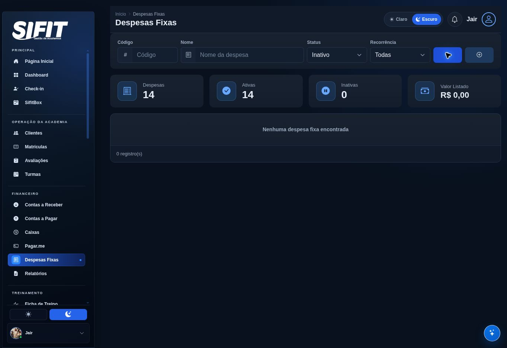

# CT089 - Filtro de despesas fixas

## Objetivo

Verificar filtro de despesas fixas.

## Pré-condições

Sessão autenticada no SIFIT Alfa. Execução em 19/11/2026.

## Passos para execução

Em Despesas Fixas, confirme a lista sem filtro, selecione Inativo e clique em Buscar.

## Resultado esperado

A lista deve mostrar somente despesas inativas ou indicar ausência de resultados.

## Resultado obtido

A lista inicial mostrou 14 despesas ativas. Com Inativo, mostrou “Nenhuma despesa fixa encontrada” e zero registros.

## Status

Aprovado para o filtro de status

## Evidência

