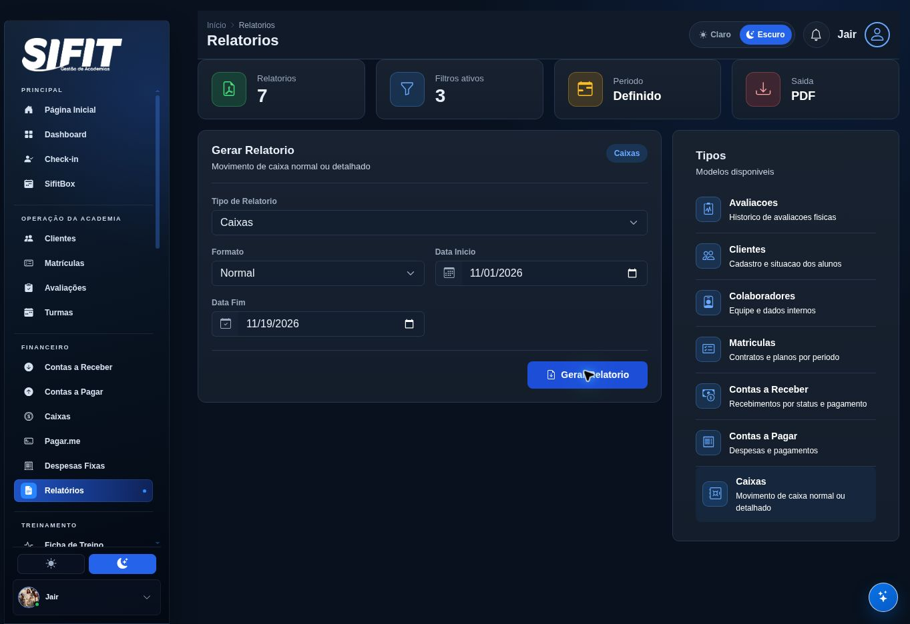

# CT090 - Geração de relatório financeiro

## Objetivo

Verificar geração de relatório financeiro.

## Pré-condições

Sessão autenticada no SIFIT Alfa. Execução em 19/11/2026.

## Passos para execução

Em Relatorios, selecione Caixas e Normal, mantenha as datas de 01/11/2026 a 19/11/2026 e clique em Gerar Relatorio.

## Resultado esperado

O sistema deve entregar um PDF válido e legível.

## Resultado obtido

O navegador registrou o download, mas o arquivo observado tinha zero bytes. Não foi possível abrir ou verificar o relatório.

## Status

Reprovado na execução observada

## Evidência

A captura mostra a configuração. O evento de download foi confirmado e o arquivo recebido tinha 0 bytes.
